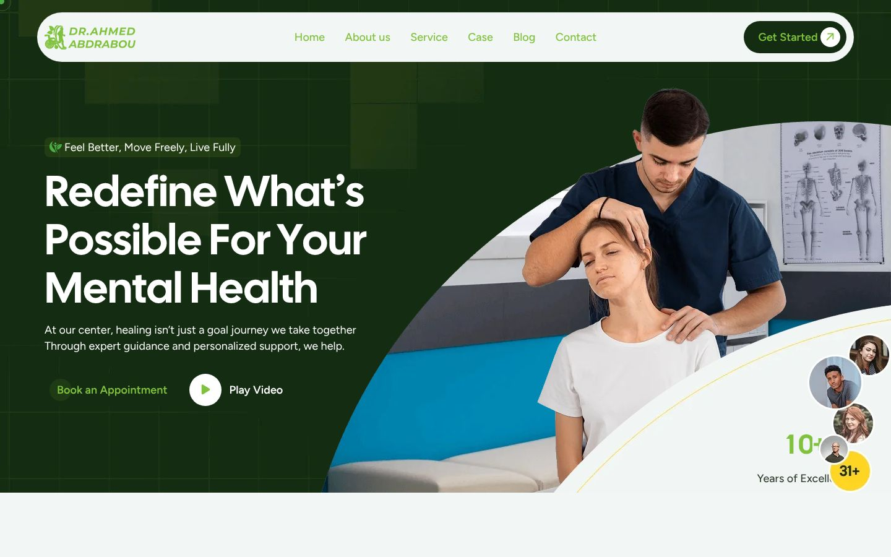
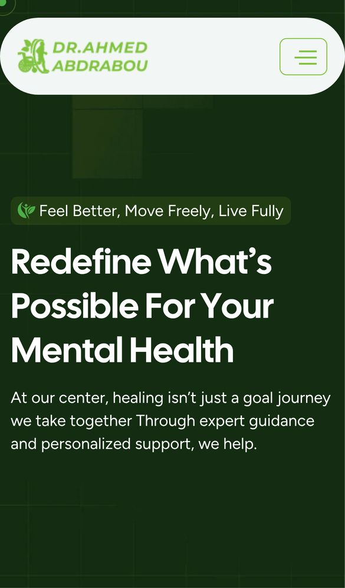
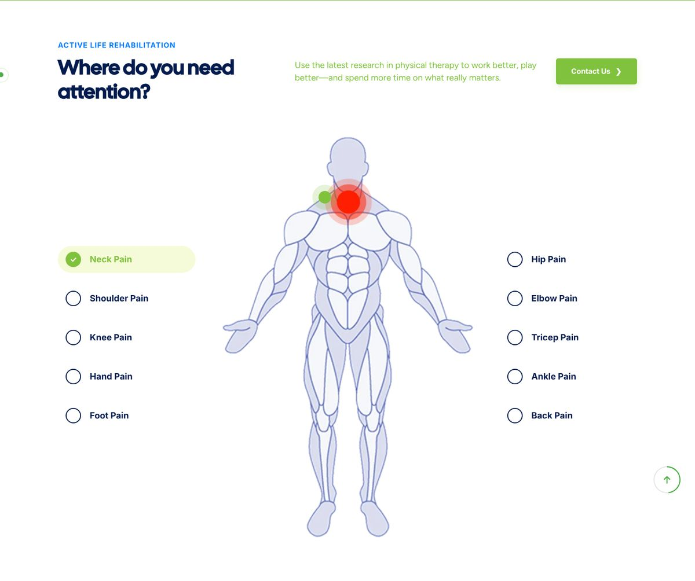

<div align="center">

# Dr. Ahmed Abdrabou – Physical Therapy Clinic

### Multi-page clinic website with an interactive body-pain map

A responsive website for Dr. Ahmed Abdrabou's physical therapy clinic: services, case studies, team, blog, FAQ and contact pages, plus a home-page body map that highlights where each type of pain is treated.

[](https://developer.mozilla.org/docs/Web/HTML)
[](https://sass-lang.com)
[](https://developer.mozilla.org/docs/Web/JavaScript)
[](https://getbootstrap.com)
[](https://swiperjs.com)
[](https://jquery.com)
<br>
[](https://physical-therapy-orpin.vercel.app)

**[Live demo](https://physical-therapy-orpin.vercel.app)** ·
**[Portfolio](https://new-portfolio-ashy-xi.vercel.app/)** ·
**[LinkedIn](https://www.linkedin.com/in/eslamraafat-dev/)** ·
**[Email](mailto:eslamraafat736@gmail.com)**

<br>



</div>

<table>
  <tr>
    <td width="33%"></td>
    <td width="67%"></td>
  </tr>
  <tr>
    <td align="center"><sub>Mobile (iPhone 13)</sub></td>
    <td align="center"><sub>"Where do you need attention?" interactive body map</sub></td>
  </tr>
</table>

---

## Contents

- [Overview](#overview)
- [Features](#features)
- [Tech stack](#tech-stack)
- [Pages](#pages)
- [Project structure](#project-structure)
- [Getting started](#getting-started)
- [Deployment](#deployment)
- [Author](#author)

## Overview

This is a client website for a physical therapy clinic run by Dr. Ahmed Abdrabou. It is built on a chiropractic / clinic HTML template that I branded for the clinic (logo and copy) and extended with a custom **interactive body-pain map** section.

The site is front-end only: the forms have no back end yet, and the phone numbers, emails and Google Map embed are still the template's placeholder values, to be replaced with the clinic's real details.

## Features

### Interactive body map (custom section)

- Ten pain areas in two lists: neck, shoulder, knee, hand, foot, hip, elbow, tricep, ankle and back.
- Hovering an item moves a pulsing marker to that spot on the body figure, using `data-x` / `data-y` coordinates on each list item (`assets/js/main.js`).
- The first item is activated on load so the section is never empty.

### Clinic site

- Hero with a parallax background (Parallaxie), a "Book an Appointment" call to action and a video pop-up (Magnific Popup).
- Swiper carousels for services, team members and testimonials (`assets/js/slider.js`).
- Animated number counters (Odometer) and scroll animations (AOS).
- Preloader, custom mouse cursor, sticky header, off-canvas mobile menu and a back-to-top progress button.
- FAQ accordion, case studies (grid and sidebar layouts), team member details, blog list and single post, service details and a custom 404 page.
- Styled `<select>` inputs with Nice Select in the contact and service-page forms.

## Tech stack

| Layer | Tools |
| --- | --- |
| Markup | HTML5, 13 static pages |
| Styling | CSS3 compiled from SCSS (`assets/scss`), Bootstrap 5.3.3, Font Awesome |
| Sliders and UI | Swiper 11.1, Magnific Popup, Nice Select, jQuery 3.7.1 |
| Animation | AOS, Odometer, Parallaxie, SmoothScroll, Waypoints |
| Hosting | Vercel |

## Pages

| Page | File |
| --- | --- |
| Home | `index.html` |
| About | `about.html` |
| Services | `service.html` |
| Service details | `service-single.html` |
| Case studies | `case.html` |
| Case studies (sidebar layout) | `case-left.html` |
| Team | `team.html` |
| Team member details | `team-details.html` |
| Blog | `blog.html` |
| Blog post | `blog-single.html` |
| FAQ | `faq.html` |
| Contact | `contact.html` |
| 404 | `404.html` |

## Project structure

```text
.
├── index.html, about.html, service*.html, case*.html, team*.html,
│   blog*.html, faq.html, contact.html, 404.html     # static pages
├── assets/
│   ├── css/
│   │   ├── style.css          # main stylesheet (compiled from scss/), includes the body-map styles
│   │   └── plugins/           # Bootstrap, Swiper, AOS, Magnific Popup, Nice Select, Odometer
│   ├── scss/                  # component/, layout/, theme/, utils/ partials
│   ├── js/
│   │   ├── main.js            # site scripts and the body-map interaction
│   │   ├── slider.js          # Swiper carousels
│   │   └── plugins/           # jQuery, Bootstrap, Swiper, AOS, Odometer, Parallaxie …
│   └── img/                   # logo, photos and icons
└── docs/screenshots/          # README screenshots
```

## Getting started

No build step is needed.

```bash
git clone https://github.com/Eslamraafat1/Physical-therapy.git
cd Physical-therapy
npx serve .          # or open index.html in a browser
```

## Deployment

The site is deployed as a static site on **Vercel**: [physical-therapy-orpin.vercel.app](https://physical-therapy-orpin.vercel.app).

## Author

**Eslam Raafat** – Front-End Developer (React / Next.js / TypeScript)

- **Portfolio:** [new-portfolio-ashy-xi.vercel.app](https://new-portfolio-ashy-xi.vercel.app/)
- **LinkedIn:** [linkedin.com/in/eslamraafat-dev](https://www.linkedin.com/in/eslamraafat-dev/)
- **GitHub:** [@Eslamraafat1](https://github.com/Eslamraafat1)
- **Email:** [eslamraafat736@gmail.com](mailto:eslamraafat736@gmail.com)

---

© Dr. Ahmed Abdrabou. Code shared for portfolio purposes.
